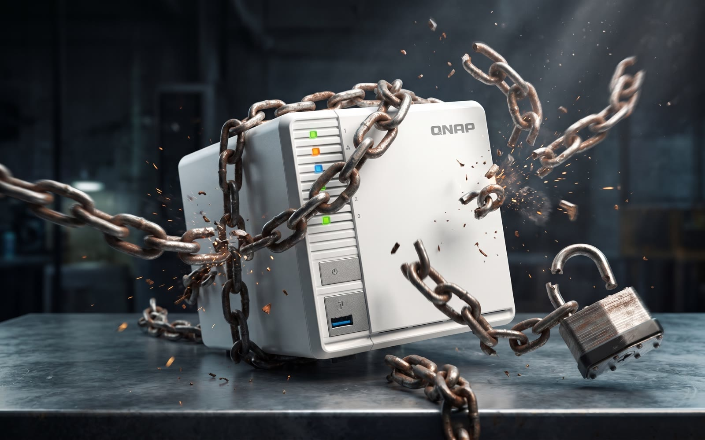

# ts328-unchained

Mainline Linux and Debian for the **QNAP TS-328**, a 3-bay NAS built on the
**Realtek RTD1296** (4x Cortex-A53, 2 GB RAM).

The stock firmware runs a vendor 4.2.8 kernel that no longer gets security
fixes. This project replaces it with **Linux 6.18 LTS** plus a patch series,
and **Debian 12** (bookworm, with Debian LTS security support until June
2028) on top. The kernel is built with Debian-style hardening (stack
protector, AppArmor, Yama, Landlock, hardened usercopy and more). U-Boot
stays untouched, and QTS can be restored from your backup at any time.

Most of the drivers cover the whole **RTD129x family** (RTD1295/RTD1296), so
they may help with other boards built on these chips too.

## Status

| Hardware | 6.18 status |
|---|---|
| 4 CPU cores | Works (RTD1295 spin-table enable method) |
| CPU frequency scaling | Works, 300 MHz to 1.4 GHz (schedutil), with the L2 rail scaled as in the vendor tables |
| Thermal sensor, throttling | Works |
| eMMC (boot and root) | Works, read and write (~15 MB/s read, ~7 MB/s write) |
| SATA, all 3 bays | Works (SoC AHCI for bays 1-2, ASMedia behind PCIe for bay 3) |
| PCIe (both slots) | Works |
| LAN 1 (RTL8111 on PCIe) | Works, 1 Gbit/s |
| LAN 2 (SoC GMAC) | Works, 1 Gbit/s |
| USB 3.0 / 2.0 | Works (the driver enables the USB clock that the boot loader leaves off) |
| RTC (RX8010) | Works |
| Front panel MCU: power button, power-off, LEDs, buzzer, fan, board temperature | Works (mainline `qnap-mcu`) |
| Speaker (audio CPU) | Works: spoken boot and shutdown prompts |
| Reset / USB-copy buttons | Registered; reboot key ignored until polarity is verified |
| Watchdog | Works: restart, and systemd keeps it fed (`RuntimeWatchdogSec=30s`) |

## How it boots

The vendor U-Boot loads `Image`, `realtek.dtb`, `initrd.boot` and
`bluecore.audio` from eMMC partition 2 and checks them against plain CRC32
`*.cksum` files. This project puts the 6.18 kernel there with a small
stage-1 initrd that finds the Debian root on eMMC partition 7 and switches
to it. On a recovery boot (USB-copy button held) it prefers a root on a USB
stick instead.

Three vendor U-Boot limits matter, all handled by `kernel/build.sh`
(`tools/mkboot.sh` does the same for an existing build tree):

- `booti` copies the kernel to *DRAM base + text_offset* and ignores the
  "place anywhere" flag, so the Image header gets `text_offset = 0x200000`.
- The kernel footprint must end below the audio firmware at `0x1b00000`.
- A gzip-compressed Image may be at most 20 MiB once decompressed.

Holding the front **USB Copy** button at power-on makes U-Boot load the same
four files from partition 2 of a USB stick instead ("factory recovery"
mode). That makes testing safe: nothing on the eMMC changes, as long as
the stick carries the `initrd.boot` built here. (With QTS's own initrd,
this boot clones the whole stick onto the eMMC.)

## Layout

| Path | Contents |
|---|---|
| `kernel/patches/` | the patch series on top of Linux v6.18.64 (`git am`) |
| `kernel/configs/` | config fragments, merged on top of `allnoconfig` |
| `kernel/build.sh` | clone, patch, configure, build and package |
| `stage1/` | stage-1 initrd (busybox, plus mdadm for the optional read-only root) and its build script |
| `debian/` | rootless Debian 12 root filesystem build (mmdebstrap) |
| `platform/` | front panel, fan, RAID event, voice-prompt, eMMC-write, read-only-root and rescue-stick tools and systemd units |
| `tools/` | `mkboot.sh` (boot set packaging); `emmc-boot1-test.c` (development test that writes the eMMC boot1 area; not needed for installation) |
| `docs/` | installation and hardware notes |

See [docs/INSTALL.md](docs/INSTALL.md) and [docs/HARDWARE.md](docs/HARDWARE.md).

## Safety

- Back up the whole eMMC (user area and the boot0/boot1 hardware boot
  areas) and the SPI flash before changing anything. The installation
  guide shows how.
- The eMMC driver has a read-only mode. The production kernel enables
  writes (`dw_mmc_rtd129x.allow_writes=1`) and refuses user-area writes
  below eMMC partition 7 (`write_min_lba=1009664`), so partitions 1-6,
  including the boot partition 2, are write-protected in normal use.
  Writes to the boot0/boot1 hardware boot areas and to RPMB are refused.
- U-Boot lives in SPI flash, which this kernel has no driver for; nothing
  here can write it.
- `/dev/mem` is restricted (`STRICT_DEVMEM`, `IO_STRICT_DEVMEM`), so it
  cannot be used to bypass the eMMC protection.

## Credits

- Andreas Färber's RTD1295 mainline work was the starting point for
  several drivers: the IRQ mux driver and its binding are his (ported to
  6.18), and the PCIe driver and the SoC device tree build on his
  work-in-progress tree.
- Realtek's BSP and QNAP's and Synology's GPL kernel sources were the
  references for the hardware details; the driver headers name their
  sources and keep the original copyright notices.
- The voice prompts in `platform/voice/sounds` were synthesized with Piper
  (https://github.com/OHF-Voice/piper1-gpl, GPL-3.0-or-later) using the
  en_US-joe-medium voice, which was trained on the CC0 "joe" dataset and
  fine-tuned from the CC0 "rdh" base model. The recipe is
  `platform/voice/render-prompts-piper.sh`. The generated audio is
  distributed under the project license.

## License

Copyright (C) 2026 HuskerMinion and contributors.

Unless a file says otherwise, this project is licensed under GPL-2.0-only;
see [LICENSE](LICENSE). The kernel patches add files to Linux and follow the
kernel's licensing: each new file carries its own SPDX-License-Identifier
(GPL-2.0-only, GPL-2.0-or-later, or (GPL-2.0-only OR BSD-2-Clause) for
device tree bindings).

Binary releases: a kernel built from this repository is Linux v6.18.64 plus
`kernel/patches` at the same tag. `initrd.boot` contains these Debian
packages: busybox-static 1.35.0-4+deb12u1+b1, mdadm 4.2-5, libudev1
252.39-1~deb12u2 and libc6 2.36-9+deb12u14. Their source is at
https://snapshot.debian.org/package/<name>/<version>/ (busybox:
https://snapshot.debian.org/package/busybox/1.35.0-4%2Bdeb12u1/). The audio
CPU firmware (`bluecore.audio`) is not distributed; copy it from your own
device.

QNAP and TS-328 are trademarks or registered trademarks of QNAP Systems,
Inc.; Realtek is a trademark of Realtek Semiconductor Corp. They are used
here only to identify the hardware this project supports. This project is
not affiliated with, sponsored by or endorsed by QNAP or Realtek.
